## 1. HC_SR04

<small>[1.1. STM32CubeMX Trig](#11-stm32cubemx-trig)</small>

<small>[1.2. Generate Code1](#12-generate-code1)</small>

<small>[1.3. Oscilloscope1](#13-oscilloscope1)</small>

<small>[2.1. STM32CubeMX HC_SR04](#21-stm32cubemx-hc_sr04)</small>

<small>[2.2. Generate Code2](#22-generate-code2)</small>

<small>[2.3. Oscilloscope2](#23-oscilloscope2)</small>

---

### 1.1. STM32CubeMX Trig

GPIOA 핀을 PA0에 연결하고, TIM1을 사용한다.

<table>
  <tr>
    <td align="center">
      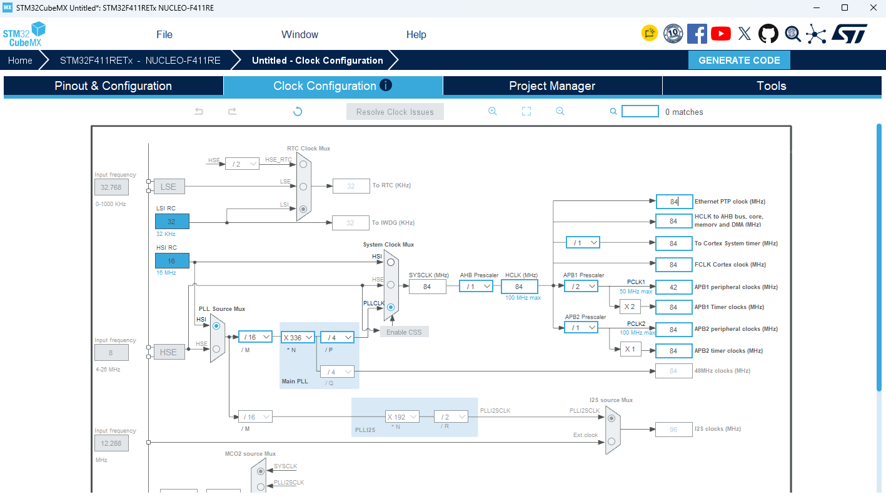
    </td>
    <td align="center">
      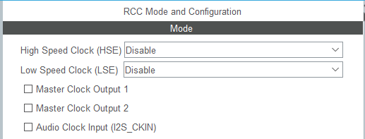
    </td>
  </tr>
  <tr>
    <td align="center">
      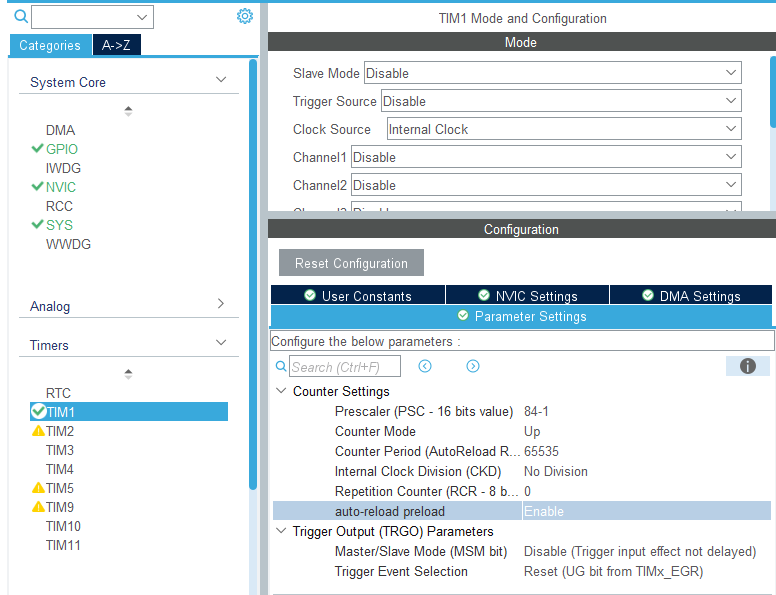
    </td>
    <td align="center">
      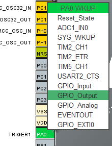
    </td>
  </tr>
</table>

1. Clock Configuration

2. RCC

   - HSE, LSE Disable (내부 HSI 사용)

3. TIM1

   - Clock Source : Internal Clock
   - Prescaler : `84-1`
   - Counter Period : `65535`
   - 84 MHz / 84 = 1 MHz → 카운터 1 증가 = 1us

4. GPIO

   - PA0 : GPIO_Output, User Label `TRIGER1`
   - PA2 / PA3 : USART2 TX / RX (printf 확인용, 115200 bps), 기본 설정값

5. `GENERATE CODE`로 코드 생성


### 1.2. Generate Code1

1. TIM1을 시작하고, 카운터 값을 이용한 `delay_us` 함수를 작성한다.

```c
void timer_start(void)
{
    HAL_TIM_Base_Start(&htim1);
}

void delay_us(uint16_t us)
{
    __HAL_TIM_SET_COUNTER(&htim1, 0);
    while ((__HAL_TIM_GET_COUNTER(&htim1)) < us);
}
```

   - Prescaler가 `84-1`이므로 TIM1 카운터는 1㎲마다 1씩 증가한다.
   - 따라서 카운터 값 = 지연 시간(㎲)이 된다.
   - `timer_start()`는 `main()`의 while 문 이전에 한 번 호출한다.

2. TRIG 핀으로 10 ㎲ HIGH 펄스를 출력한다.

```c
void trig(void)
{
    HAL_GPIO_WritePin(TRIGER1_GPIO_Port, TRIGER1_Pin, HIGH);
    delay_us(10);
    HAL_GPIO_WritePin(TRIGER1_GPIO_Port, TRIGER1_Pin, LOW);
}
```

| 신호 | 동작 | F411RE 설정 |
|---|---|---|
| TRIG | 10us HIGH 펄스로 측정 시작 | PA0 GPIO Output |
| ECHO | HIGH 유지 시간 = 초음파 왕복 시간 | GPIO Input (추후 측정) |

   - ECHO가 HIGH를 유지하는 시간을 재면 거리를 계산할 수 있다.

3. 먼저 `HAL_Delay(1)`로 TRIG 펄스가 반복되는지 확인한다.

```c
while (1)
{
    trig();
    HAL_Delay(1);
}
```

4. ㎲ 단위 제어를 위해 `HAL_Delay(1)`을 `delay_us(200)`으로 수정한다.

```c
while (1)
{
    trig();
    delay_us(200);
}
```

   - `HAL_Delay()`는 SysTick 1 ms tick을 기준으로 동작하므로 ㎲ 단위 지연에는 사용할 수 없다.
   - `delay_us()`는 TIM1 카운터를 직접 확인하므로 1 ㎲ 단위 지연이 가능하다.


### 1.3. Oscilloscope1

1. 오실로스코프 Probe를 PA0(A0)에 연결하고, GND를 보드 GND에 연결한다.

2. `HAL_Delay(1)` 사용 시 TRIG 파형을 확인한다.

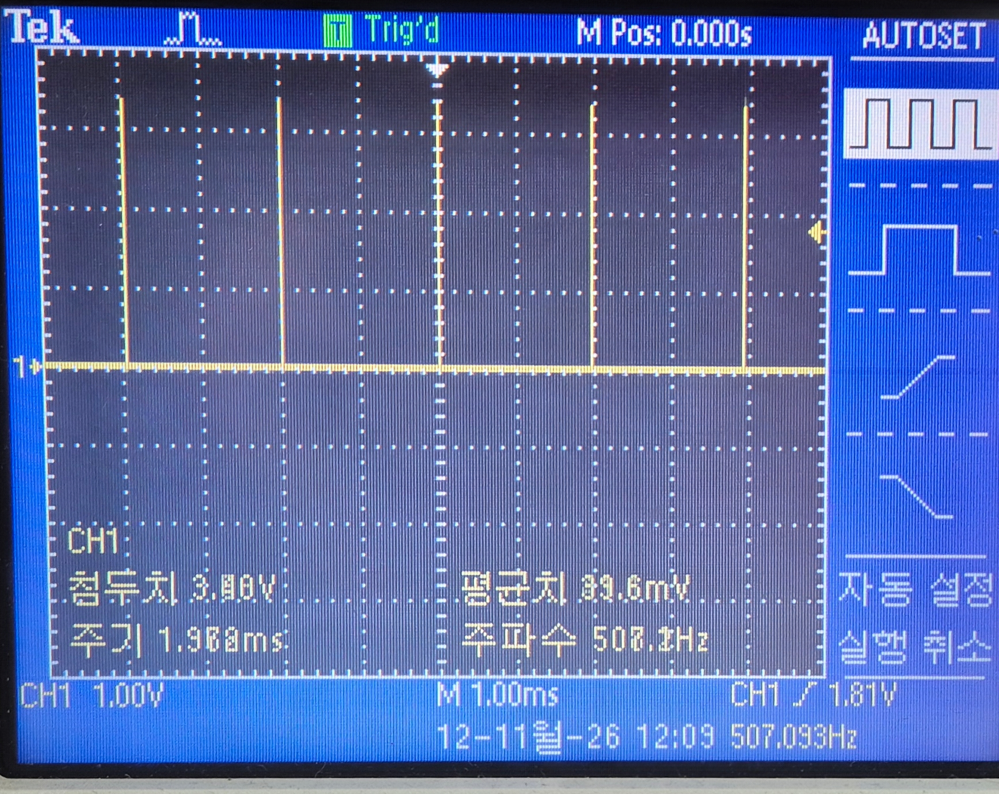
<br>

   - 오실로스코프 시간축 : `M 1.00ms`
   - 측정 주기 : 약 2 ms
   - 측정 주파수 : 507.033 Hz
   - `HAL_Delay(1)`은 내부적으로 1 tick을 더 기다리기 때문에 실제 지연이 1~2 ms 사이가 된다.
   - 따라서 1 ms 주기를 의도한 것과 실제 TRIG 주기가 맞지 않는다.

3. `delay_us(200)` 사용 시 TRIG 파형을 확인한다.
   - Cursor로 인접한 상승 에지 사이의 시간차를 측정 : Δt = 208.0us

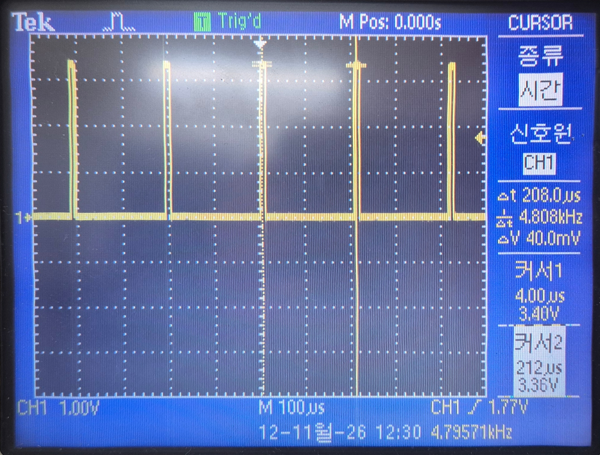
<br>


### 2.1. STM32CubeMX HC_SR04

목표 : HC-SR04 초음파 센서를 사용해서 거리 측정을 진행한다.

이전 진행한 설정에서 Echo 설정만 새로 수정한다.
1. GPIO

   - PA0 : GPIO_Output, User Label `TRIGER1`
   - PA1 : GPIO_Input, User Label `ECHO1`
   - PA2 / PA3 : USART2 TX / RX (printf 확인용, 115200 bps), 기본 설정값

5. `GENERATE CODE`로 코드 생성


### 2.2. Generate Code2

이전 코드에서 echo 함수와 거리 측정에 대한 printf를 추가한다. 

1. echo 함수를 수정한다.

```c
uint32_t echo(void) {
    uint32_t start_tick, start_time, end_time;

    // ECHO HIGH 대기 (최대 10ms)
    start_tick = HAL_GetTick();
    while (HAL_GPIO_ReadPin(ECHO1_GPIO_Port, ECHO1_Pin) == GPIO_PIN_RESET) {
        if ((HAL_GetTick() - start_tick) > 10) return 0;  // 10ms 초과 → 실패
    }
    start_time = __HAL_TIM_GET_COUNTER(&htim1);

    // ECHO LOW 대기 (최대 30ms = HC-SR04 최대 측정 시간)
    start_tick = HAL_GetTick();
    while (HAL_GPIO_ReadPin(ECHO1_GPIO_Port, ECHO1_Pin) == GPIO_PIN_SET) {
        if ((HAL_GetTick() - start_tick) > 30) return 0;  // 30ms 초과 → 범위 초과
    }
    end_time = __HAL_TIM_GET_COUNTER(&htim1);

    return end_time - start_time;
}
```

2. trig(), echo()를 진행한 후 얻은 echo_time으로 거리를 계산한다.

```c
  /* Infinite loop */
  /* USER CODE BEGIN WHILE */
  while (1)
  {
	  trig();
	  echo_time = echo();
	  	      if( echo_time != 0){
	  	          dist = (int)(17 * echo_time / 100);
	  	          printf("Distance = %d(mm)\n", dist);
	  	      }
	  	      else printf("Out of Range!\n");
    /* USER CODE END WHILE */
```

3. Putty에서 serial 통신 데이터(측정된 거리)를 출력한다.

<table>
  <tr>
    <td align="center">
      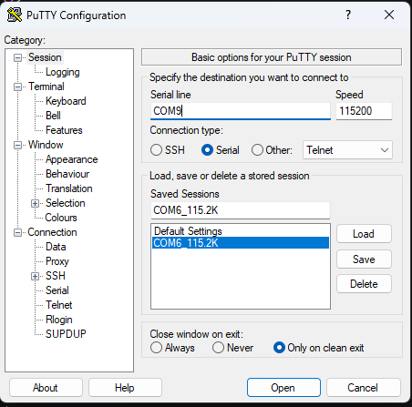
    </td>
    <td align="center">
      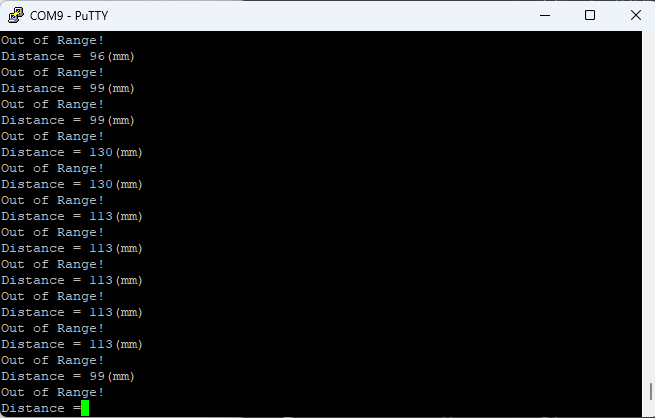
    </td>
  </tr>
</table>


### 2.3. Oscilloscope2

1. 오실로스코프 Probe를 PA0(A0)에 연결하고, GND를 연결한다.

2. HC-SR04의 송신 pulse 8개를 확인한다.

3. 센서의 수신 신호에 따라 변화하는 TRIG 파형을 확인한다.

<table>
  <tr>
    <td align="center">
      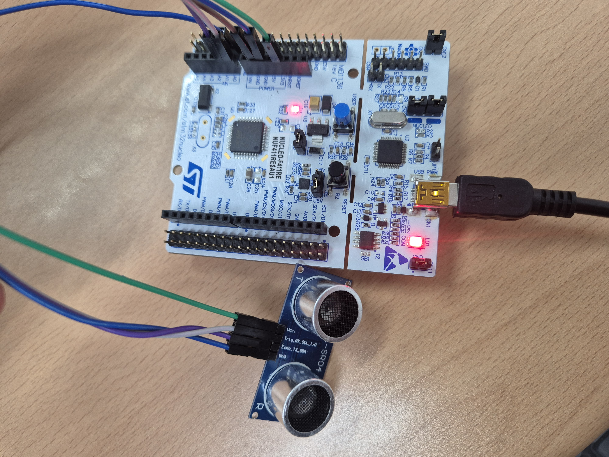
    </td>
    <td align="center">
      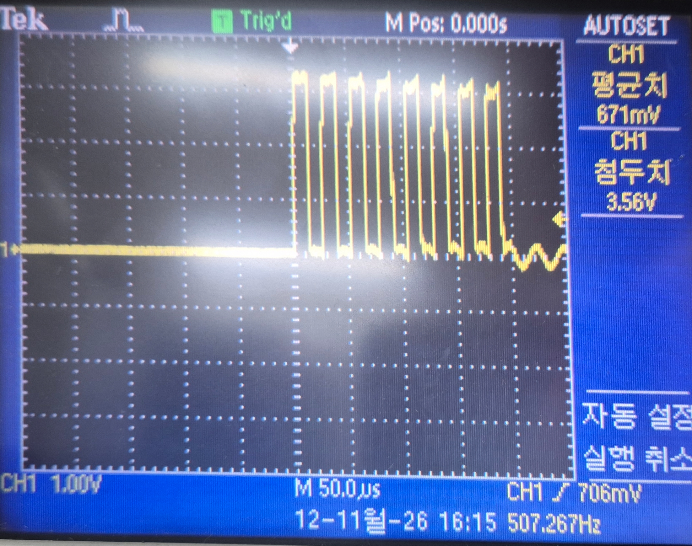
    </td>
  </tr>
  <tr>
    <td align="center">
      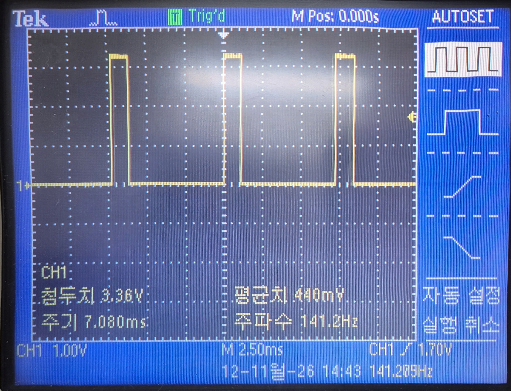
    </td>
    <td align="center">
      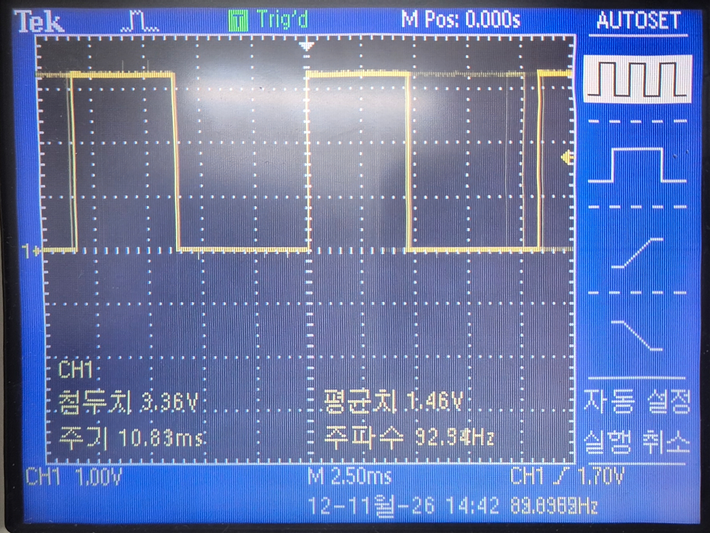
    </td>
  </tr>
</table>


[목차](../README.md)
---
