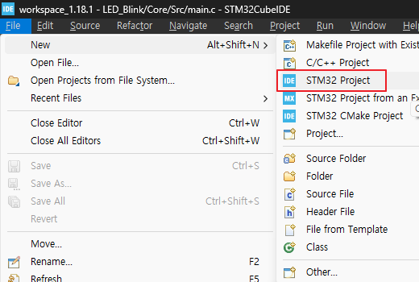
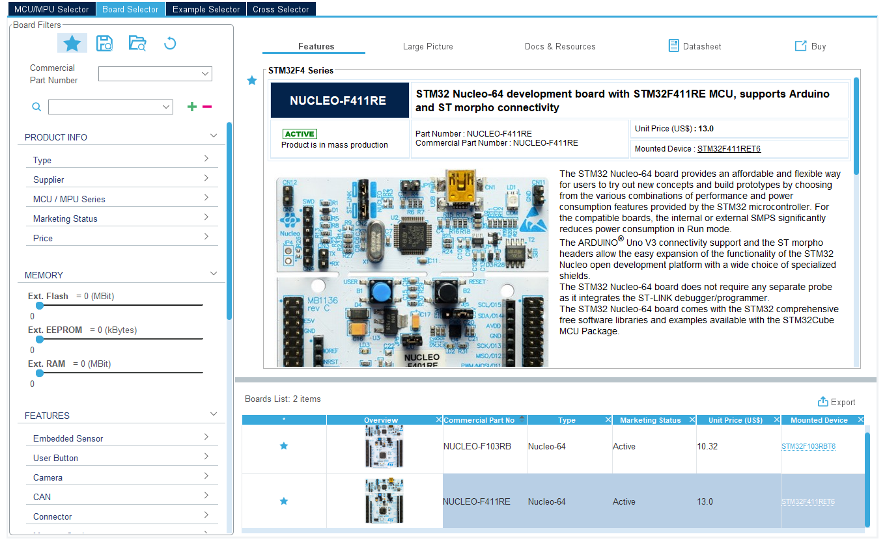
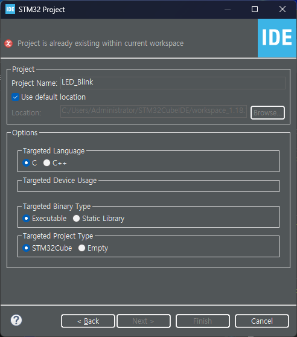
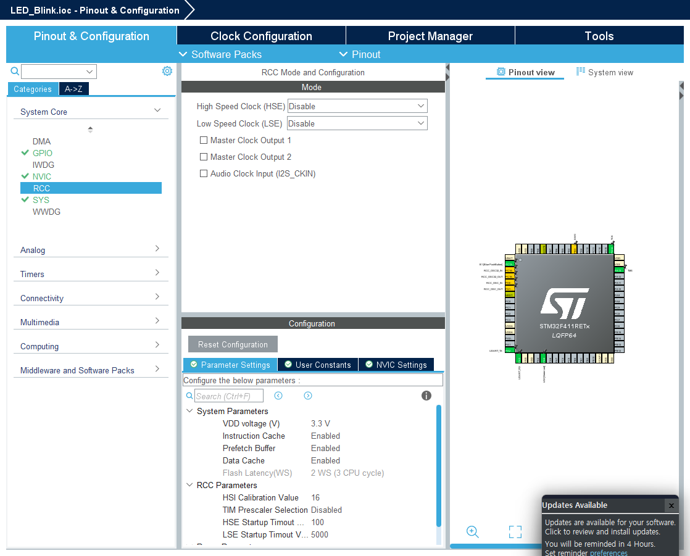
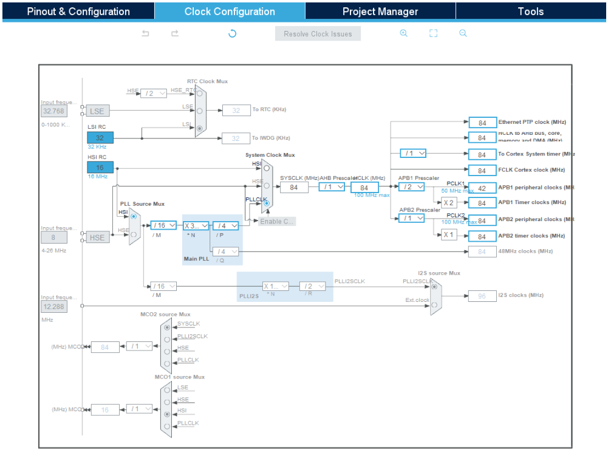
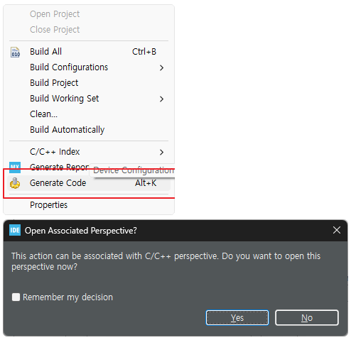

## 1. LED_Blink


<br>


<br>


<br>


<br>


<br>


<br>

* main.c
```c
  /* USER CODE BEGIN WHILE */
  while (1)
  {
	  HAL_GPIO_WritePin(LD2_GPIO_Port, LD2_Pin, 1);
	  HAL_Delay(1000);
	  HAL_GPIO_WritePin(LD2_GPIO_Port, LD2_Pin, 0);
	  HAL_Delay(1000);

    // HAL_GPIO_TogglePin(LD2_GPIO_Port, LD2_Pin);
    // HAL_Delay(1000);
    /* USER CODE END WHILE */

    /* USER CODE BEGIN 3 */
  }
```

