## 1. LED_Blink

<small>[1.1. STM32CubeMX](#11-stm32cubemx)</small>

<small>[1.2. Debugging](#12-debugging)</small>

<small>[1.3. Reference Manual 확인 및 GPIO 설정 변경](#13-reference-manual-확인-및-gpio-설정-변경)</small>

<small>[1.4. Oscilloscope](#14-oscilloscope)</small>

---


### 1.1. STM32cubeMX

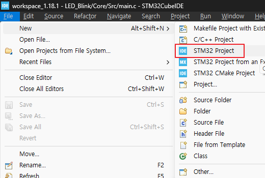
<br>

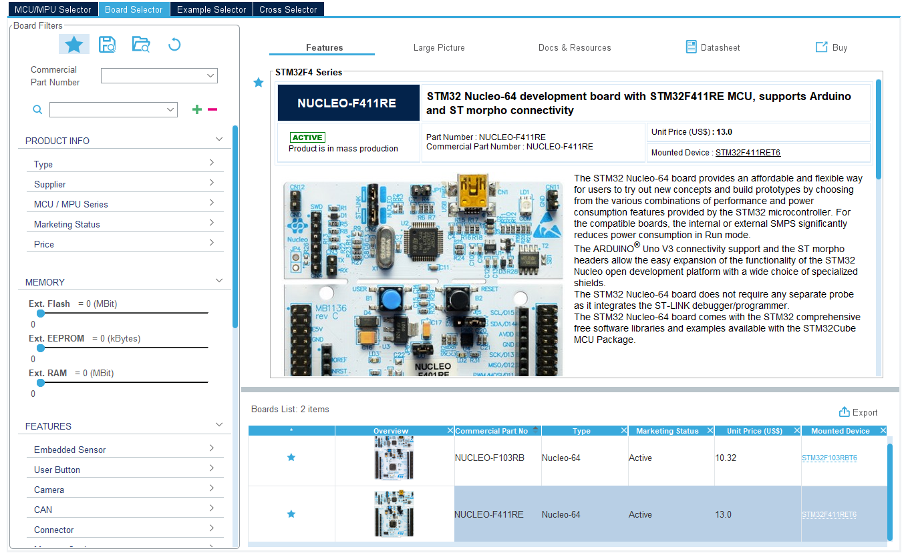
<br>

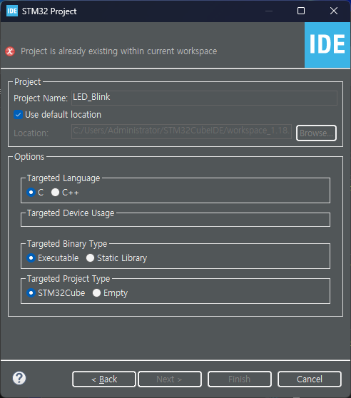
<br>

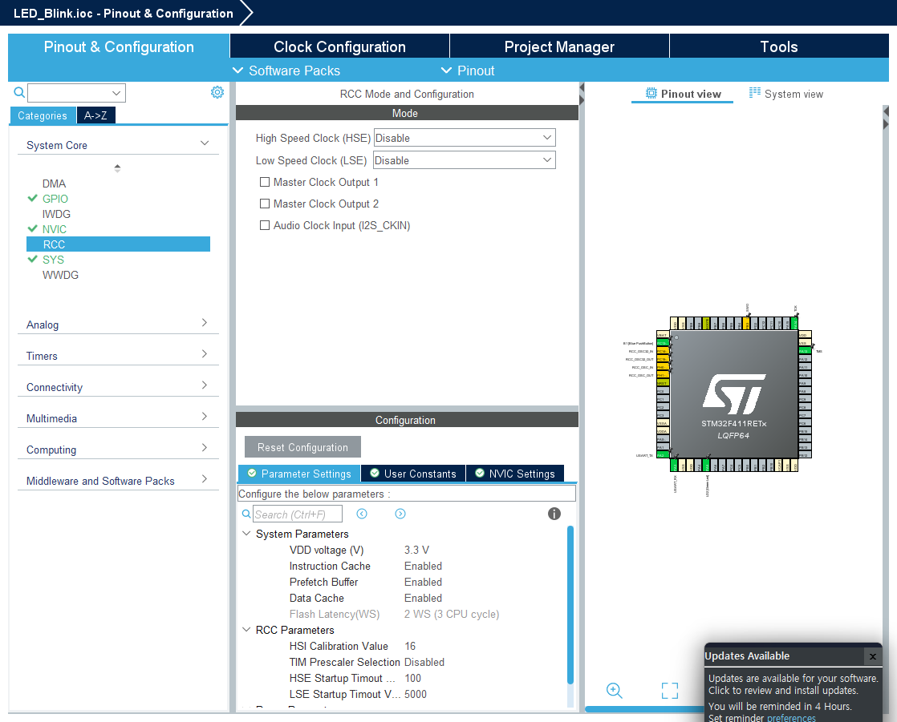
<br>

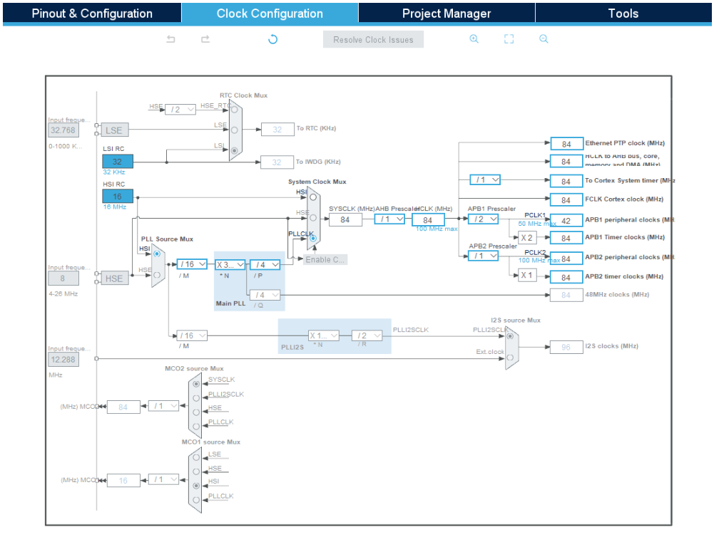
<br>

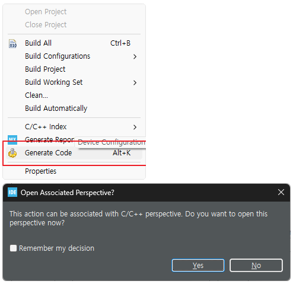
<br>


* main.c
```c
  /* USER CODE BEGIN WHILE */
  while (1)
  {
	  HAL_GPIO_WritePin(LD2_GPIO_Port, LD2_Pin, 1);
	  HAL_Delay(1000);
	  HAL_GPIO_WritePin(LD2_GPIO_Port, LD2_Pin, 0);
	  HAL_Delay(1000);

    // HAL_GPIO_TogglePin(LD2_GPIO_Port, LD2_Pin);
    // HAL_Delay(1000);
    /* USER CODE END WHILE */

    /* USER CODE BEGIN 3 */
  }
```


### 1.2. Debugging

1. Debug Mode

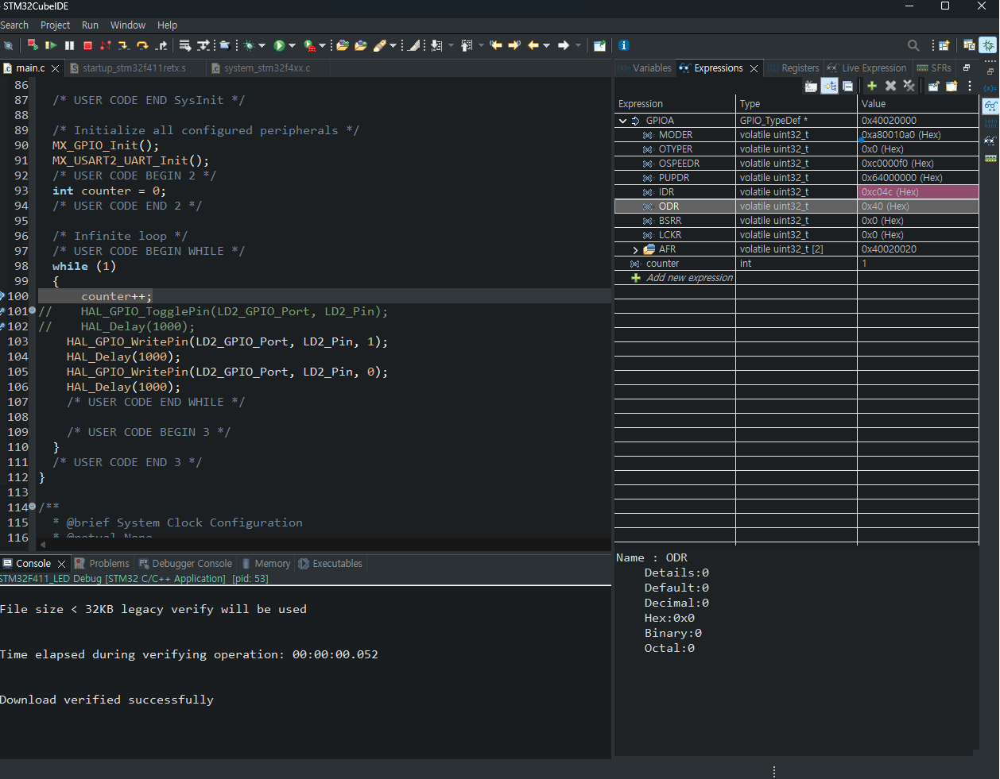
<br>

2. `Expressions` 창에서 `GPIOA_MODER` 값 확인 (0xa80004a0)

3. PA5의 MODER 비트 확인
   - PA5 : MODER[11:10]
   - `01` : Output Mode

4. `GPIOA_ODR` 값을 변경(20 입력)하여 LED 점등 확인

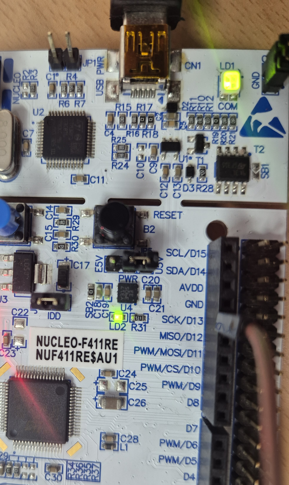
<br>

| ODR 값 | 동작 |
|---|---|
| `0x00` | LED OFF |
| `0x20` | PA5 HIGH → LED ON |


### 1.3. Reference Manual 확인 및 GPIO 설정 변경

[RM0383 Reference Manual : STM32F411xC/E advanced Arm  -based 32-bit MCUs](https://www.st.com/resource/en/reference_manual/rm0383-stm32f411xce-advanced-armbased-32bit-mcus-stmicroelectronics.pdf)

<table>
  <tr>
    <td align="center">
      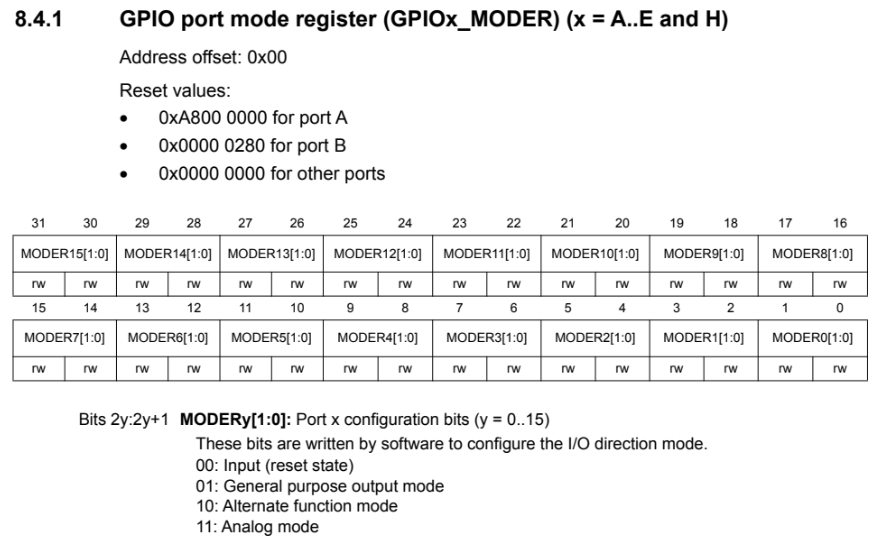
    </td>
    <td align="center">
      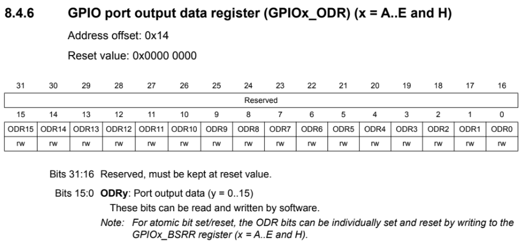
    </td>
  </tr>
</table>

1. Reference Manual STM32F411RE PA6 핀 정보 확인

2. GPIOA_MODER register에서 PA6의 비트 위치 확인
   - PA6 : MODER[13:12]

3. 기존 PA5 설정을 해제하고 PA6을 Output Mode로 변경

4. HEX 값을 계산하여 `GPIOA_MODER` 수정 (0xa80010a0)

5. `GPIOA_ODR` 값을 변경하여 PA6 출력 확인 (40 입력)

**MODER 설정**

| 핀 | MODER 비트 | 설정값 |
|---|---|---|
| PA5 | [11:10] | 00 (Input) |
| PA6 | [13:12] | 01 (Output) |

**ODR 설정**

| ODR 값 | 동작 |
|---|---|
| `0x00` | PA6 LOW |
| `0x40` | PA6 HIGH |

※ PA6은 LED가 연결된 핀이 아니므로 LED 점등 대신 오실로스코프로 출력 신호를 확인한다.


### 1.4. Oscilloscope

1. PA6 핀에 오실로스코프 Probe 연결

2. GND 연결 확인

3. `GPIOA_ODR` 값을 `0x00`과 `0x40`으로 변경

4. 오실로스코프에서 출력 전압 변화 확인
    - TRIG MENU `모드` 확인

5. 상승 엣지(Rising Edge)와 하강 엣지(Falling Edge) 확인

<table>
  <tr>
    <td align="center">
      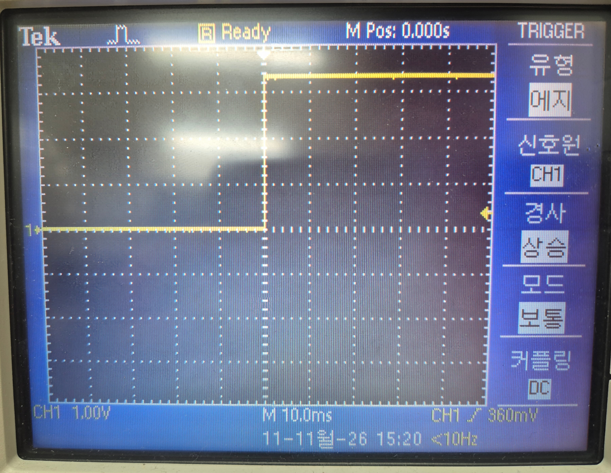
    </td>
    <td align="center">
      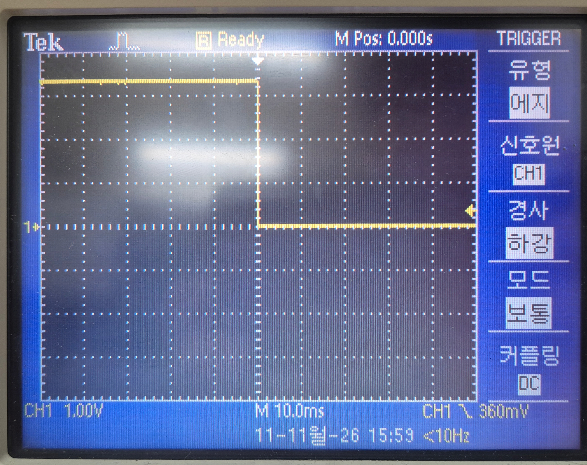
    </td>
  </tr>
</table>


[목차](../README.md)
---